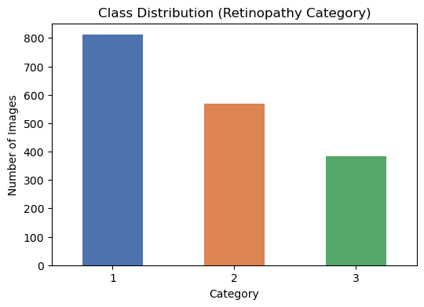
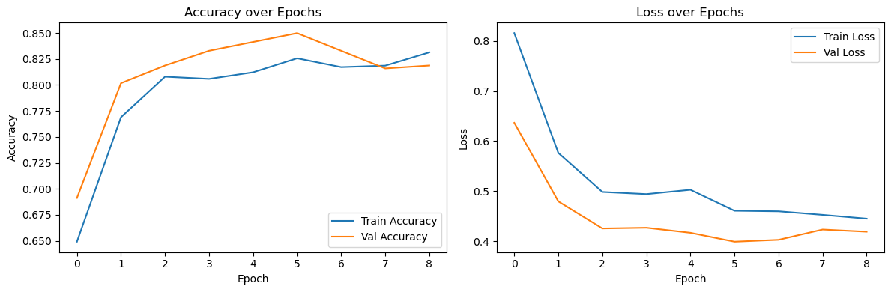
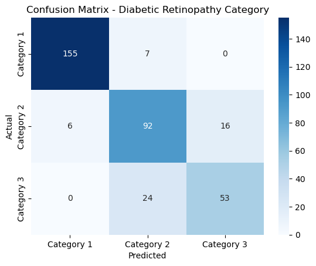

# Diabetic Retinopathy Detection

Deep learning model that classifies retina fundus images into one of three diabetic retinopathy categories, with Grad-CAM heatmaps and a Gradio demo app.

Built as a **client project during my AI Engineer internship at Rubixe**. (I completed my AI Engineering course at DataMites.)

> **Disclaimer:** This is an educational project. It is not a medical device and must not be used for diagnosis.

## Business Case

Retinopathy is damage to the retina, the light-sensitive tissue at the back of the eye. It is commonly linked to diabetes and high blood pressure and can lead to vision loss if not detected early. The goal is a model that predicts the retinopathy category of a retina scan, so that screening can be supported by an automated first pass.

## Dataset

| Item | Detail |
|---|---|
| Source | Client-provided dataset (not included in this repo) |
| Images | 1,764 retina images in a single `images/` folder |
| Labels | `data_all.csv` maps `file` to `cat` (category 1, 2 or 3) |
| Class counts | Category 1: 811, Category 2: 569, Category 3: 384 (imbalance ratio 2.11:1) |
| Split | Stratified 80/20: 1,411 train / 353 validation |



## Approach

1. **Data validation:** confirmed every CSV entry matches an image file (0 mismatches).
2. **Stratified split:** `train_test_split(stratify=cat)` so both splits keep the same class proportions.
3. **Preprocessing and augmentation:** resize to 160x160, rescale to [0, 1], horizontal flip, rotation (15 degrees), zoom (0.1), brightness (0.9 to 1.1).
4. **Transfer learning:** frozen ImageNet-pretrained **MobileNetV2** backbone, then GlobalAveragePooling, Dense(64, ReLU), Dense(3, softmax). 82,179 trainable parameters out of 2,340,163.
5. **Imbalance handling:** balanced class weights computed on the training split only.
6. **Training control:** Adam optimizer, categorical cross-entropy, EarlyStopping on `val_loss` (patience 3, best weights restored). Training stopped after 9 epochs.
7. **Interpretability:** Grad-CAM heatmaps on the last convolutional layer (`Conv_1`).
8. **Demo:** Gradio app that returns the predicted category, class probabilities and a Grad-CAM overlay.

## Results (validation set, 353 images)

| Class | Precision | Recall | F1 | Support |
|---|---|---|---|---|
| Category 1 | 0.96 | 0.96 | 0.96 | 162 |
| Category 2 | 0.75 | 0.81 | 0.78 | 114 |
| Category 3 | 0.77 | 0.69 | 0.73 | 77 |
| **Accuracy** | | | **0.85** | 353 |
| Macro avg | 0.83 | 0.82 | 0.82 | 353 |




Category 3 is the weakest class: 24 of 77 images were predicted as Category 2 (recall 0.69). None were predicted as Category 1.

## Challenges and What I Learned

- **Flat folder with CSV labels.** Images were not sorted into class folders, so I used `flow_from_dataframe` instead of `flow_from_directory` and validated filename matching first.
- **Invalid validation split.** My first attempt used `ImageDataGenerator(validation_split=0.2)`, which slices by row order. Because the CSV was sorted by class, the validation set contained only Category 1 images, which made the early metrics misleading. I switched to a stratified split and checked class proportions in both sets before retraining.
- **Class imbalance (2.11:1).** Handled with balanced class weights computed on the training split only.
- **Small dataset.** 1,764 images is too few to train a CNN from scratch, so I used a frozen pretrained backbone with augmentation and early stopping.

## Limitations

- The same 353-image validation set was used for early stopping and for the reported metrics. There is no separate held-out test set, so the numbers are likely somewhat optimistic.
- Grad-CAM was checked qualitatively on a few images. It has not been validated against clinical annotations.
- Category 3 recall (0.69) is too low for any real clinical use. Next steps would be more data for the higher categories, fine-tuning the backbone, a higher input resolution, and tuning the decision threshold toward recall for Category 3.
- The dataset only provides numeric categories 1 to 3. Their clinical meaning should be confirmed with the client before labelling them in a user-facing app.

## Project Structure

```
.
├── README.md
├── requirements.txt
├── app.py                      # Gradio demo
├── notebooks/
│   └── diabetic_retinopathy_detection.ipynb   # full workflow with outputs
├── src/
│   ├── train.py                # training + evaluation script
│   └── gradcam.py              # Grad-CAM helpers
├── data/README.md              # where to place the client dataset
├── models/                     # trained model is saved here
├── results/                    # metrics and plots written by train.py
└── assets/                     # charts used in this README
```

## Setup and Usage

```bash
git clone https://github.com/alfrid420/<repo-name>.git
cd <repo-name>
python -m venv .venv
.venv\Scripts\activate          # Windows  (use: source .venv/bin/activate on macOS/Linux)
pip install -r requirements.txt
```

1. Put the dataset in `data/ratinopathy/` (see `data/README.md`).
2. **Option A, notebook:** open `notebooks/diabetic_retinopathy_detection.ipynb` and run all cells.
3. **Option B, script:**
   ```bash
   python src/train.py --data-dir data/ratinopathy
   ```
   This saves the model to `models/retinopathy_model.keras` and writes the report and plots to `results/`.
4. **Run the demo:**
   ```bash
   python app.py
   ```
   Then open the local URL shown in the terminal (usually http://127.0.0.1:7860).

The notebook was developed with Python 3.13 on Windows with TensorFlow/Keras (CPU).

## Tech Stack

Python, TensorFlow/Keras, MobileNetV2, scikit-learn, pandas, NumPy, OpenCV, Matplotlib, Seaborn, Gradio, Jupyter

## Author

**Monu Mishra**
[GitHub](https://github.com/alfrid420) | [LinkedIn](https://www.linkedin.com/in/monu-mishra-b55998357/) | [Portfolio](https://monu-portfolio-5wf1.vercel.app/)
